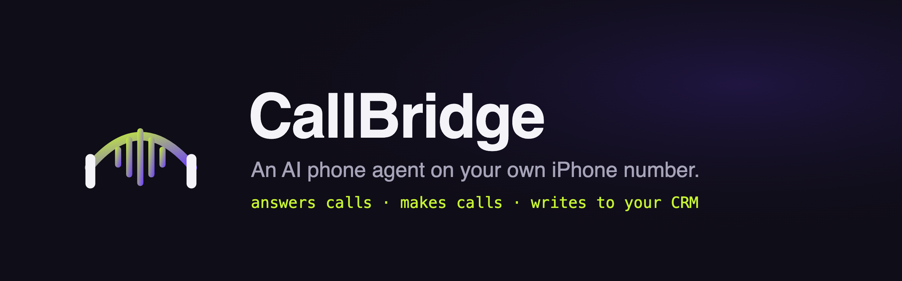
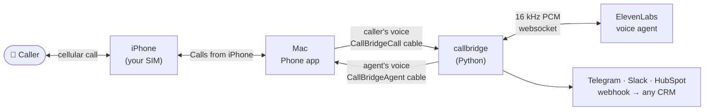

<p align="center">
  
</p>

<p align="center">
  <a href="https://github.com/Digitaicoil/callbridge/actions/workflows/ci.yml"></a>
  <a href="LICENSE"></a>
  
  
  <a href="#set-it-up-with-claude-code"></a>
</p>

<p align="center">
  <b>CallBridge turns the iPhone in your pocket into an AI receptionist and sales caller.</b><br>
  It answers and makes real calls on your own number, through your Mac, with an ElevenLabs voice agent,<br>
  and drops every call's summary into Telegram, Slack, HubSpot or any CRM.
</p>

<p align="center">
  <a href="#quick-start">Quick start</a> ·
  <a href="docs/how-it-works.md">How it works</a> ·
  <a href="docs/integrations.md">Integrations</a> ·
  <a href="docs/costs.md">Costs</a> ·
  <a href="docs/troubleshooting.md">Troubleshooting</a> ·
  <a href="docs/responsible-use.md">Responsible use</a>
</p>

---

<!-- demo video: drop assets/demo.mp4 here once recorded -->

## Why

Every AI phone agent today wants you to rent a new virtual number, port your line or pay a telecom per minute.
Your customers already have **your** number. CallBridge puts the AI on that number:

- **No new number, no telecom bill.** Calls go out and come in on your real SIM, through Apple's *Calls from iPhone*.
- **No hardware.** Two virtual audio cables on your Mac carry the call to the agent and back. No speaker, no mic, no echo.
- **Your CRM, not ours.** Every call ends as a structured record: who, why, when to call back, outcome, summary,
  transcript. Send it to Telegram, Slack, HubSpot, or anything with a webhook (Zapier, Make, n8n, Pipedrive, Monday, Salesforce…).

## What it does

| | |
|---|---|
| 📥 **Receptionist** | Answers incoming calls when you can't, greets as your business, answers from what you taught it, takes a message, ends the call. |
| 📤 **Outbound caller** | Calls a number you give it, with context ("Dana, asked about whitening last week"), qualifies, books a callback with you. |
| 🧾 **Call records** | Caller name, reason, callback time and outcome extracted from every call, plus the summary and transcript. |
| 🔌 **Integrations** | Telegram (incl. group topics), Slack, HubSpot (contact + note), generic webhook, local JSONL. Add your own in ~20 lines. |
| 🛑 **Do-not-call** | Anyone who asks not to be called again lands on a list the dialer refuses to call. |
| 🎙️ **Recording** | Optional stereo WAV (caller left, agent right) for review and training. |
| 🤖 **Claude Code plugin** | `/callbridge:setup` walks you through the whole install; `/callbridge:tune-agent` reshapes how it talks. |

## How it works



During a call the Mac's default speaker is the *call* cable and its default microphone is the *agent* cable, so the
Phone app sends the caller's voice to CallBridge and takes the agent's voice as if it were your mic. CallBridge streams
both to an ElevenLabs Conversational AI agent, keeps it quiet until someone actually picks up (it filters out the ring
tone), notices when the other side hangs up, ends the call, puts your audio devices back and ships the call record.
Full walkthrough: [docs/how-it-works.md](docs/how-it-works.md).

## Requirements

- A Mac (Apple silicon or Intel) on macOS 14 or newer, with **Xcode** installed (to build the audio cables)
- An iPhone with a SIM, signed in to the same Apple Account, with *Calls on Other Devices* turned on
- An [ElevenLabs](https://elevenlabs.io) account with Conversational AI (API key)
- Python 3.10+

## Quick start

```bash
# 1. install
pipx install git+https://github.com/Digitaicoil/callbridge     # or: uv tool install git+https://...

# 2. the two virtual audio cables (built from BlackHole's source on your Mac)
callbridge cables build
callbridge cables install            # asks for your password: installs the drivers, restarts Core Audio

# 3. your key and agent
mkdir -p ~/.config/callbridge
curl -fsSL https://raw.githubusercontent.com/Digitaicoil/callbridge/main/.env.example -o ~/.config/callbridge/.env
open -e ~/.config/callbridge/.env    # paste your ELEVENLABS_API_KEY
callbridge agent create receptionist \
  --business "Bright Smile Dental" --owner "Dana" --agent-name "Ava" \
  --about "Dental clinic in Austin. Open Sun-Thu 9-18. Cleanings, whitening, implants."
#   → prints CALLBRIDGE_INBOUND_AGENT_ID=...  add it to the .env

# 4. check, then go
callbridge doctor
callbridge answer                    # receptionist: answers incoming calls until Ctrl-C
callbridge menubar                   # the same, with an On/Off switch in the Mac's menu bar
callbridge restore                   # give the Mac its own mic and speakers back
callbridge call +15551234567 "Dana's patient, asked about whitening"   # or: one outbound call
```

The step-by-step version, with every setting spelled out, is **[docs/setup.md](docs/setup.md)**.

### Set it up with Claude Code

CallBridge is also a [Claude Code](https://claude.com/claude-code) plugin. Claude installs it, builds the cables,
interviews you about your business, writes the agent, connects your CRM and runs the first test call with you:

```text
/plugin marketplace add Digitaicoil/callbridge
/plugin install callbridge@callbridge
/callbridge:setup
```

## Send calls to your CRM

```bash
# ~/.config/callbridge/.env
CALLBRIDGE_SINKS=jsonl,telegram,hubspot
```

Every call becomes one record:

```json
{
  "direction": "inbound",
  "number": "+1 555 123 4567",
  "started_at": "2026-11-17T10:42:05",
  "duration_s": 74,
  "summary": "Dana Levi wants a cleaning next week; prefers mornings.",
  "data": { "caller_name": "Dana Levi", "reason": "book a cleaning", "callback_time": "tomorrow morning", "outcome": "message_taken" },
  "transcript": ["Agent: Hi, you've reached Bright Smile Dental...", "Caller: Hi, I'd like to book a cleaning..."]
}
```

| Sink | What happens | Setup |
|---|---|---|
| `jsonl` | appended to `~/Library/Logs/callbridge/calls.jsonl` | nothing (default) |
| `telegram` | summary message to a chat or group topic | bot token + chat id |
| `slack` | summary message to a channel | incoming webhook URL |
| `hubspot` | contact found or created by phone, call note attached | private app token |
| `webhook` | the full JSON record POSTed anywhere | URL (+ optional secret) |

Zapier, Make, n8n, Pipedrive, Monday, Salesforce, Google Sheets, Airtable, Notion: point `webhook` at them.
Recipes in [docs/integrations.md](docs/integrations.md).

## Shape what the agent says

The agents are plain prompts in [`agents/`](agents/). Edit, then push:

```bash
callbridge agent push receptionist --business "Bright Smile Dental" --owner "Dana" --about "..."
callbridge agent calls receptionist 10      # how recent calls went: length, credits, summary
```

Every agent must say it's an AI in its opening; `create` and `push` refuse one that doesn't.

## Costs

CallBridge is free. You pay ElevenLabs for the agent (voice, speech recognition and LLM together), measured on our
own calls at **about 400 credits per minute** with `eleven_v4_turbo` and `claude-haiku-5-5`. Phone minutes come from
your normal mobile plan. Details and how to estimate: [docs/costs.md](docs/costs.md).

## Responsible use

A voice that sounds human makes this powerful, and easy to misuse. CallBridge is built for calls people expect:

- the agent **says it's an AI** in every call (enforced in code);
- **call only people who agreed** to hear from you, and follow your local telemarketing, consent and call-recording laws;
- honour **do-not-call** requests (built in).

Read [docs/responsible-use.md](docs/responsible-use.md) before your first outbound call.

## Limitations

- macOS only (it relies on Apple's *Calls from iPhone*). One call at a time per Mac.
- The Mac must stay unlocked during calls: a locked screen can't press the call buttons. A keep-awake agent is included.
- Hanging up restarts macOS's call service (`callservicesd`); macOS brings it straight back.
- If you also automate the iPhone (Appium / WebDriverAgent), stop it during calls. See [troubleshooting](docs/troubleshooting.md).

## Roadmap

- [ ] Warm transfer to your own phone mid-call
- [ ] Calendar booking (Google Calendar / Cal.com) as an agent tool
- [ ] Menu-bar app with call log and on/off switch
- [ ] More sinks: Pipedrive, Google Sheets, Notion (PRs welcome)

## Contributing

Issues and PRs are welcome. Start with [CONTRIBUTING.md](CONTRIBUTING.md). Security reports: [SECURITY.md](SECURITY.md).

## Credits

- [BlackHole](https://github.com/ExistentialAudio/BlackHole) by Existential Audio (GPL-3.0): the virtual audio driver
  the cables are built from. CallBridge builds it from source on your Mac and does not redistribute it.
- [ElevenLabs Conversational AI](https://elevenlabs.io/conversational-ai): the voice agent.

## License

[MIT](LICENSE) © Itai Boublil · Built at [DigitAI](https://digitai.co.il), where we build AI systems for businesses.
